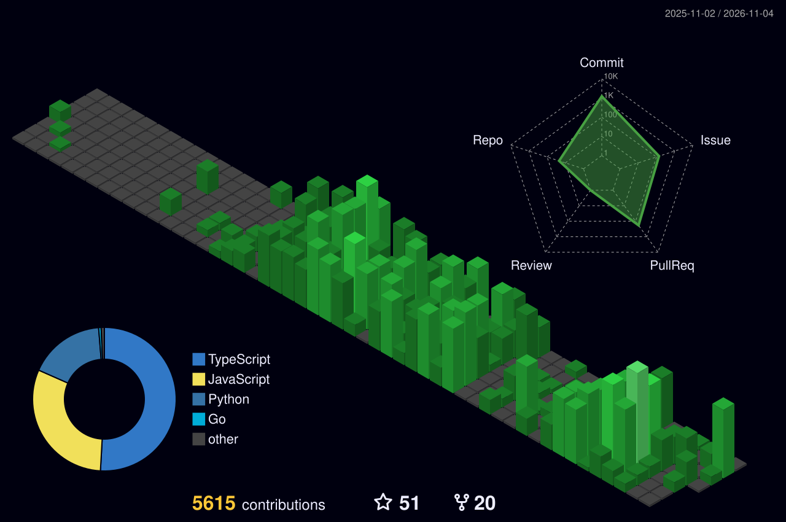

# Hi, I'm Philipp

## Open Source Contributions

<!-- CONTRIB:START -->
**10 merged pull requests in 4 upstream projects** · 11 more in review

| Project | ★ | Merged |
|:--|--:|:--|
|  **[qax-os/excelize](https://github.com/qax-os/excelize)** Go language library for reading and writing Microsoft Excel™ (XLAM / XLSM / XLSX / XLTM / XLTX) spreadsheets | 21.1k | [Resolve worksheet prefixed single cell reference in INDIRECT](https://github.com/qax-os/excelize/pull/2423) [Anchor the wildcard match of the lookup functions](https://github.com/qax-os/excelize/pull/2418) [Make a negative zero the same zero as any other](https://github.com/qax-os/excelize/pull/2424) [Give det the determinant of a single element](https://github.com/qax-os/excelize/pull/2420) [Read an empty cell as zero in VALUE](https://github.com/qax-os/excelize/pull/2422) [Return a logical value from OR and read every argument](https://github.com/qax-os/excelize/pull/2419) [Count an empty string in COUNTA](https://github.com/qax-os/excelize/pull/2421) |
|  **[kewisch/ical.js](https://github.com/kewisch/ical.js)** Javascript parser for ics (rfc5545) and vcard (rfc6350) data | 1.2k | [Look up the offset of UTC times as UTC when converting between zones](https://github.com/kewisch/ical.js/pull/1050) |
|  **[natelindev/tsdav](https://github.com/natelindev/tsdav)** WebDAV, CALDAV, and CARDDAV client for js runtimes and the Browser | 361 | [Answer HTTP Digest challenges for authMethod 'Digest'](https://github.com/natelindev/tsdav/pull/284) |
|  **[zfutura/pycheval](https://github.com/zfutura/pycheval)** Factur-X/ZUGFeRD parsing and generation library for Python | 27 | [Add payment means codes 54 and 68](https://github.com/zfutura/pycheval/pull/72) |

**In review:** [qax-os/excelize](https://github.com/qax-os/excelize/pulls?q=author%3APhilflowIO+is%3Aopen) (6) · [NVIDIA-NeMo/Speech](https://github.com/NVIDIA-NeMo/Speech/pulls?q=author%3APhilflowIO+is%3Aopen) (1) · [docker/mcp-registry](https://github.com/docker/mcp-registry/pulls?q=author%3APhilflowIO+is%3Aopen) (1) · [omarroth/doubletake](https://github.com/omarroth/doubletake/pulls?q=author%3APhilflowIO+is%3Aopen) (1) · [zfutura/pycheval](https://github.com/zfutura/pycheval/pulls?q=author%3APhilflowIO+is%3Aopen) (1) · [CynepMyx/deja](https://github.com/CynepMyx/deja/pulls?q=author%3APhilflowIO+is%3Aopen) (1)

**Listed in:** [punkpeye/awesome-mcp-servers](https://github.com/punkpeye/awesome-mcp-servers) (★ 97.3k)
<!-- CONTRIB:END -->

## Contribution Snake

<picture>
  <source media="(prefers-color-scheme: dark)" srcset="https://raw.githubusercontent.com/PhilflowIO/PhilflowIO/output/github-snake-dark.svg" />
  <source media="(prefers-color-scheme: light)" srcset="https://raw.githubusercontent.com/PhilflowIO/PhilflowIO/output/github-snake.svg" />
  
</picture>

## 3D Contribution Graph

## GitHub Metrics

## Activity & Contributions

## Streaks

## Activity Graph

